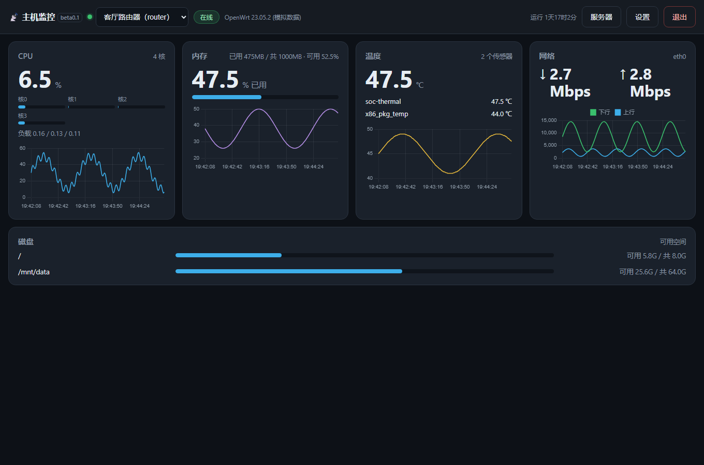
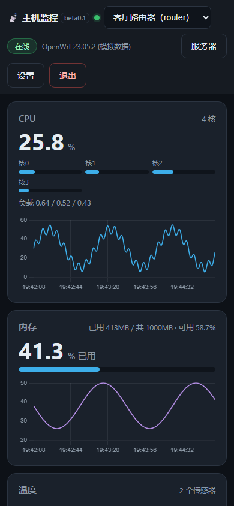
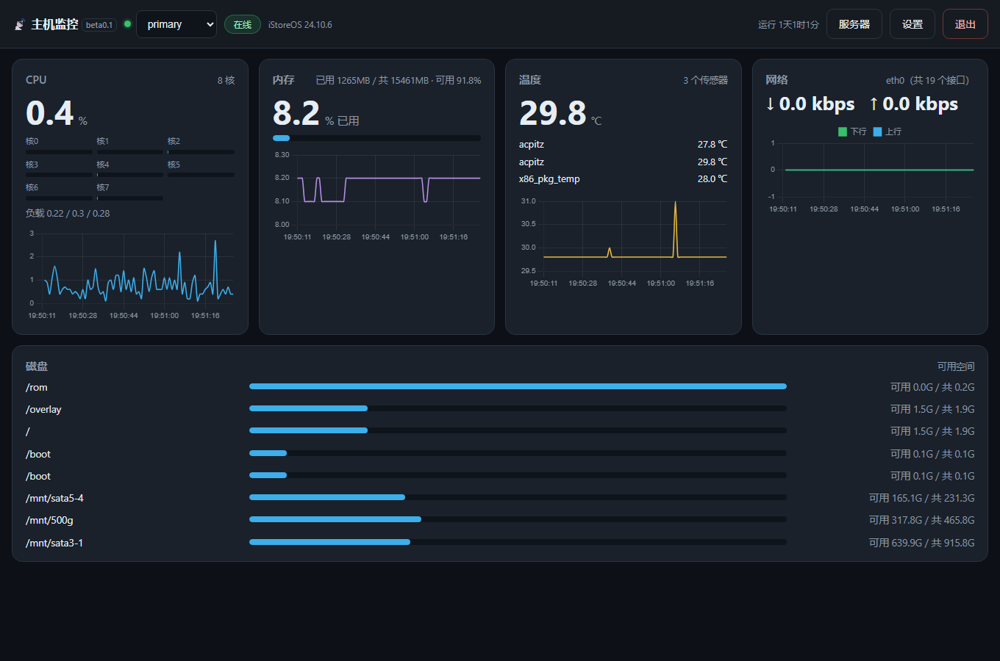

<p align="center">
  
</p>

<h1 align="center">主机监控小助手 · Host Monitor Assistant</h1>

<p align="center">
  <b>零探针（Agentless）的 Linux 主机实时监控</b> —— 被监控机只要开着 SSH，<b>什么都不用装</b>。<br>
  Rust 单进程后端 + 原生 Web 界面，Windows 桌面端 / 浏览器 / 安卓手机三端同源。
</p>

<p align="center">
  <a href="LICENSE"></a>
  
  
  
  
</p>

<p align="center">
  
</p>

---

## 目录

- [它是什么](#它是什么)
- [设计取向](#设计取向)
- [和常见方案比](#和常见方案比)
- [功能一览](#功能一览)
- [快速开始](#快速开始)
- [从源码编译](#从源码编译)
- [配置与安全](#配置与安全)
- [目录结构](#目录结构)
- [常见问题](#常见问题)
- [实测数据](#实测数据)
- [开源协议](#开源协议)

## 它是什么

一个把「家里 / 机房里那几台 Linux 机器现在怎么样」这件事做到**装完即用**的监控工具：

- **被监控端零安装**：不装 agent、不开额外端口、不改配置。一条 SSH 长连接注入只读采集脚本
  （`sh -s`，内存执行、不落盘），CPU / 内存 / 温度 / 风扇 / GPU / 磁盘 / 全部网卡 / Docker 容器负载秒级刷新。
- **监控端一个进程**：Rust 后端（axum + russh + SQLite）与桌面壳（Tauri）编译在**同一个 exe** 里。
  没有 Python 运行时、没有数据库服务、没有 Docker、没有 sidecar 子进程。
- **三端同源**：Windows 桌面安装包（3.1 MiB）、独立后端浏览器版（单文件 7 MB）、
  安卓 App（Rust 编成 `.so` 经 JNI 在 App 进程内跑，独立分支仓库）。

适合：软路由 / NAS / homelab / 小机房 / 开发板（树莓派、RISC-V 板子）……
凡是 BusyBox、OpenWrt、iStoreOS、Debian、Ubuntu、Alpine 这类「装不动重型 agent」的机器，它都吃得下。

<p align="center">
  
  
</p>

## 设计取向

它不做「什么都监控」，只把下面几件事做扎实：

### 1. 被监控机近乎零足迹
远端只执行 `cat /proc/*`、`df`、`docker ps/stats` 等**只读命令**，脚本经 stdin 注入内存执行，
不写文件、不留常驻进程、不开端口。对闪存寿命敏感的软路由 / eMMC 开发板比较友好。
（对比：Netdata 要装包跑服务，node_exporter 要开 9100 端口，Zabbix agent 要改配置注册。）

### 2. 弱环境可用
采集脚本是纯 POSIX sh + awk，BusyBox 直接跑：OpenWrt / iStoreOS 不需要 bash、Python、coreutils。
实测 iStoreOS 一台上解析出 19 张网卡、Docker 容器、4 路风扇、3 路温度。

### 3. 单文件就是完整监控系统
后端 + SSH 客户端 + 历史库（内嵌 SQLite）+ Web 服务器 + 告警推送 + 拨测，全在一个
`xmm-server.exe` 里。拷一个文件到任意 Windows 机器双击即可作为监控中心。

### 4. 告警闭环自带，不依赖 Alertmanager
温度 / 内存 / 根分区阈值告警 + 按主机/资源/挂载点的持续型规则（触发线 / 恢复线 / 持续秒数，带滞回），
边沿检测去重，恢复通知带持续时长，静默时段，心跳。
推送通道：Server酱（微信）/ Telegram / SMTP 邮件 / 自定义 WebHook。
另附 TCP / HTTP / Ping 服务拨测（连续失败防抖 + 恢复事件）。

### 5. 中文优先，报错说人话
连接失败直接告诉你「密码错 / 端口没开 / 指纹不对 / 网络不可达」，而不是抛一行 TLS 栈。
界面、文档、告警文案全中文。

## 和常见方案比

只列对选型最关键的几行，完整维度请自行实测：

| | 本项目 | Netdata | Prometheus + node_exporter + Grafana | Zabbix |
|---|---|---|---|---|
| 被监控机安装 | **零（只要 SSH）** | 装 agent | 装 exporter | 装 agent |
| OpenWrt / BusyBox 目标 | **原生支持** | 不支持 | 勉强 | 勉强 |
| 监控端体积 | **约 3 MiB 安装包 / 7 MB 单文件** | 数百 MB | 三件套 | Server + DB |
| 告警推送 | **微信 / TG / 邮件 / WebHook 内置** | Netdata Cloud | Alertmanager | 内置（配置较繁） |
| 适合规模 | 1~50 台 | 单机深度诊断 | 大规模 / 云原生 | 企业级 |

说明：如果你要的是上万节点的云原生可观测性、分布式追踪、自定义 PromQL 大盘，请选 Prometheus 生态；
本项目专注「少量主机的实时状态 + 告警闭环」，并把这个场景做到尽可能轻。

## 功能一览

- **实时曲线**（5 分钟环形缓冲）：CPU 总/每核、负载、内存、最高温度、网络上下行
- **多网卡**：全部接口逐行展示，自动评选主网卡；点选任意接口"监督"，速率 kbps/Mbps/Gbps 或 KiB/s/MiB/s/GiB/s 双格式自适应
- **磁盘**：使用率 + 读写速率（MiB/s / GiB/s 切换），设备名 / 挂载点显示切换
- **温度 / 风扇 / GPU**：hwmon 全传感器；NVIDIA / AMD / Intel GPU 占用、显存、温度、功耗
- **Docker**：容器列表 + 每容器 CPU / 内存 / 网络 IO / 块 IO（`docker stats` 口径）
- **历史趋势**：SQLite 落盘（默认保留 90 天，可调），任意指标 1 分钟~1 年查询，自动降采样
- **告警**：阈值 + 持续型资源规则，边沿去重 / 恢复通知 / 静默时段 / 心跳，四通道推送
- **拨测**：TCP / HTTP（状态码 + 期望内容 + 耗时上限）/ Ping，防抖与恢复事件
- **多主机管理**：界面增删改查即改 `config.toml`（原子写 + .bak），改连接参数只重连那一台
- **Windows 服务**：可选 WinSW 注册开机自启（`/api/service`）
- **安全**：SSH 主机指纹严格校验（autoadd/strict）、密码可走环境变量/系统凭据管理器、Web token 鉴权、登录限速

## 快速开始

### 方式 A：Windows 桌面版（推荐）
1. 从 Releases 下载 `主机监控小助手_x.y.z_x64-setup.exe`（约 3 MiB），一路下一步（无需管理员）。
2. 打开程序 → **服务器 → 添加服务器**：填 IP / SSH 端口 / 账号 / 密码（或私钥路径）→ 测试连接 → 保存。
3. 完成。关窗口收托盘继续监控；托盘菜单或界面"退出"才真正停止。

### 方式 B：浏览器版 / 服务模式（任意 Windows 机器）
```bat
xmm-server.exe --open-browser
:: 默认 http://127.0.0.1:8787
:: 首次启动请在设置里设置 Web 密码（默认监听 0.0.0.0 时更务必设置）
```
数据与配置生成在 exe 同目录；`--config`、`--data-dir`、`--host`、`--port` 可自定义。

> **安全提示**：请勿在公网直接暴露 8787 端口。若需局域网访问，务必修改默认账号密码，
> 或把 `listen_host` 改为 `127.0.0.1` 只允许本机访问。

### 方式 C：没有目标机？先看演示
```bat
xmm-server.exe --mock --port 8899 --open-browser
:: 界面里随便加一台服务器，即出全套模拟曲线
```

### 安卓端
独立分支仓库（Rust `.so` + JNI 壳），APK 直接安装；添加服务器操作与桌面一致。
首次启动按引导把电池策略设为"无限制"，切后台/灭屏采集不断线。

## 从源码编译

前置：**Rust stable ≥ 1.77**（实测 1.99）、Windows 10/11；打包桌面安装包另需 **Node 18+**。
不需要 Python、不需要 OpenSSL（TLS 走系统 SChannel / ring）。

```bat
git clone <你的仓库地址> host-monitor && cd host-monitor

:: 1) 跑测试（42 例）
cargo test --manifest-path rs\xmm\Cargo.toml

:: 2) 浏览器版（debug 运行）
cargo run --manifest-path rs\xmm\Cargo.toml --bin xmm-server -- --mock --port 8899

:: 3) 桌面壳（debug 运行，先摆静态资源）
xcopy /E /I /Y web shell\tauri\src-tauri\resources\web
cd shell\tauri\src-tauri && cargo run

:: 4) 一键出正式安装包（release 后端 + Tauri NSIS）
packaging\build_all.bat
:: 产物：dist\主机监控小助手_*_x64-setup.exe 与 dist\xmm-server.exe
```

> Windows 上偶发 cargo jobserver 死锁（CPU 长时间零增长），构建脚本已设 `CARGO_BUILD_JOBS=1` 规避；
> 手动构建遇到卡住时同样设置该环境变量。

Linux/macOS 上可直接 `cargo run --manifest-path rs/xmm/Cargo.toml --bin xmm-server` 跑浏览器版
（桌面壳打包链路目前只针对 Windows NSIS）。

- 首次运行自动生成 `config.toml`（模板见 [config.example.toml](config.example.toml)），界面改设置即时生效并原子落盘（保留 `.bak`）。
- **密码优先级**：目标明文 password（仅兜底）→ 环境变量（`password_env` / `MON_PASSWORD`）→ Windows 凭据管理器；Web 密码支持 `MON_WEB_PASSWORD`。
- **SSH 指纹**：首连记录（autoadd），此后严格校验；可切 strict 只信任已有 known_hosts。旧 asyncssh 记录的 RSA-only 指纹兼容。
- 凭据不写日志、不回传前端（接口只回"有没有配"）；远端全部只读命令。

## 目录结构

```
rs/xmm/                 Rust 后端（唯一后端实现，42 例测试）
  src/parser.rs         行协议 → 结构化帧（逐段容错，速率本地差值）
  src/ssh.rs            russh 长连接 / 重连退避 / 看门狗 / 指纹校验
  src/state.rs          采集器生命周期 / 快照 / 告警边沿
  src/api.rs            axum 路由 / WebSocket / 鉴权
  src/store.rs          SQLite 历史（WAL / 批量写 / 降采样 / 自动清理）
  src/alerts.rs         阈值 + 持续型资源规则（滞回）
  src/notify.rs         Server酱 / Telegram / SMTP / WebHook
  src/probes.rs         TCP / HTTP / Ping 拨测
  src/bin/xmm-server.rs 独立服务 / 浏览器版入口
collector/remote/collect.sh   远端采集脚本（编译期 include_str! 内嵌，勿删）
web/                    原生 JS 前端（无构建步骤，Chart.js 本地 vendor）
shell/tauri/            Windows 桌面壳（与后端同进程，托盘/免登录）
packaging/build_all.bat 一键打包
docs/                   协议定义 / 开发文档 / 截图
scripts/                API 验收脚本
```

深入阅读：[docs/协议与数据格式.md](docs/协议与数据格式.md) · [docs/beta2.4-rust-后端重构.md](docs/beta2.4-rust-后端重构.md) · [docs/开发文档.md](docs/开发文档.md)

## 常见问题

**Q：目标机是群晖 / PVE / 树莓派可以吗？**
可以。有 SSH + POSIX sh 就行；Docker / 温度 / 风扇段按实际硬件自动出现或省略。

**Q：SSH 密码放哪安全？**
用 `password_env` 指到环境变量，或存入 Windows 凭据管理器；`config.toml` 里就不会出现明文。

**Q：断网 / 目标重启会怎样？**
指数退避自动重连（1s 起、封顶 30s），期间界面保留最后一帧并明确标注离线；
远端脚本挂起有看门狗兜底。重连后首个速率帧为 null，不产虚假尖峰。

**Q：历史数据占多少磁盘？**
长表 + 每小时自动清理过期数据（默认 90 天）。几台主机跑一年也就几十 MB 量级。

**Q：为什么不做 Linux 桌面壳？**
浏览器版在 Linux 上体验一致；桌面壳当前只出 Windows NSIS 包，欢迎 PR。

## 实测数据

以下为一台 Windows 监控端运行时的自测值，仅供参考，实际随环境和版本变动：

| 指标 | 数值 |
|---|---|
| 后端私有内存 | 8.6 MB |
| 后端工作集 | 25.4 MB |
| 桌面安装包 | 3.09 MiB |
| 进程数 | 1（壳与后端同进程） |
| 冷启动 | 秒级 |

> 欢迎提交你自己的实测环境与数据。

## 开源协议

[BSD 3-Clause](LICENSE)。可以商用、修改、闭源分发，保留版权声明即可。

欢迎 Issue / PR。如果它帮你省下了装 agent 的时间，给个 ⭐ 就是最大的支持。
